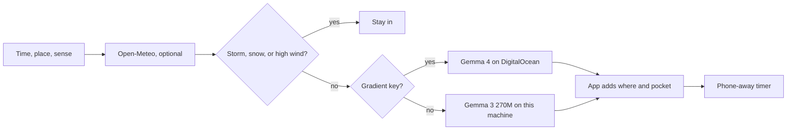

# Pocket Grass

A Gemma model finishes one outdoor sentence. You read the card, step outside, and the phone is only a timer.

Built for the [Hacktoberfest Open-Source AI Challenge: Week 1](https://dev.to/challenges/hacktoberfest-week1-2026-10-05) (Touch Grass). The entry window closes October 11, 2026 at 11:59 PM PDT (October 12, 2026 at 06:59 UTC). This project was started during that window. If any commit lands after the deadline, note it here.

## What you do

1. Pick a time (10, 20, or 40 minutes), a starting place, and what you notice first.
2. Optionally name a city. [Open-Meteo](https://open-meteo.com/) supplies the sky. No key.
3. **Gemma** finishes one sentence: the thing to notice.
   - On this computer: [Gemma 3 270M Instruct](https://huggingface.co/onnx-community/gemma-3-270m-it-ONNX) (q4, ONNX, Transformers.js, about 320MB on first run).
   - On DigitalOcean: the same app calls [Gradient serverless inference](https://docs.digitalocean.com/products/gradient-ai-platform/getting-started/quickstart/) with model id `gemma-4-31B-it`.
4. The app writes where to stand and when the phone goes away, so weather rules stay in tested code.
5. Tap **I'm stepping out**. The screen becomes a countdown. When it ends, you can keep one sentence on this device only.

Thunder, snow, or very high wind does not ask the model. The app tells you to stay in.

## Why Gemma, and why it is local unless DigitalOcean is set

The outing is the kind of note you should be able to make at the door. Gemma's weights are open. After the first download, card writing does not need the network. A city lookup does, and it is optional.

A 270M model will copy a long template. It will finish a sentence that has already started. So the sentence starts in code.

When `DIGITALOCEAN_INFERENCE_KEY` is set, the same Gemma family runs on DigitalOcean Gradient. The laptop still works with no key.

## Run locally

```bash
npm install
npm start
```

Open http://localhost:4173

```bash
npm test
```

## DigitalOcean

Copy `.env.example` to `.env` and put a Gradient model access key in `DIGITALOCEAN_INFERENCE_KEY` if you want Gemma 4 on Gradient. The app spec is `.do/app.yaml`. It hosts the Node service on App Platform and reads that secret at runtime.

```bash
doctl apps create --spec .do/app.yaml
```

Or create an App from the GitHub repo `surajns0033-collab/pocket-grass` in the DigitalOcean control panel.

## GitHub

Tests run on every push through `.github/workflows/test.yml`. Project notes for Copilot live in `.github/copilot-instructions.md`.

## How a card is made



## Credits

- Gemma 3 270M Instruct, ONNX by [onnx-community](https://huggingface.co/onnx-community/gemma-3-270m-it-ONNX), run with [Transformers.js](https://huggingface.co/docs/transformers.js).
- Gemma 4 31B Instruct on [DigitalOcean Gradient](https://docs.digitalocean.com/products/gradient-ai-platform/details/models/) (`gemma-4-31B-it`).
- Weather: [Open-Meteo](https://open-meteo.com/), CC BY 4.0.

This project's own code is MIT. See `LICENSE`.
