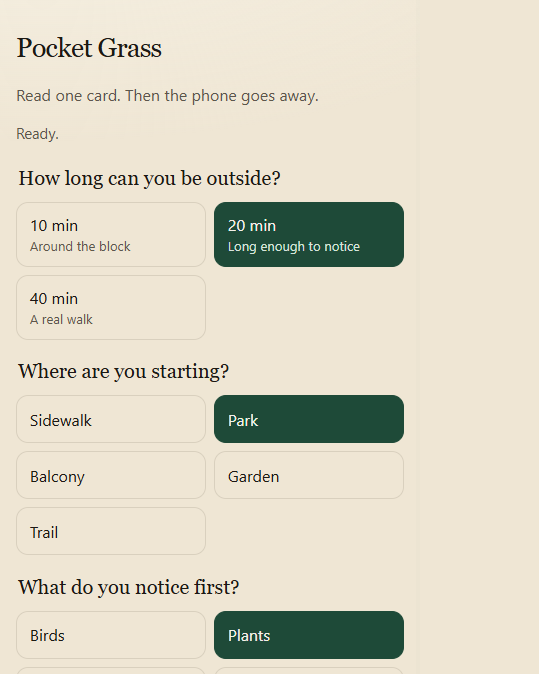
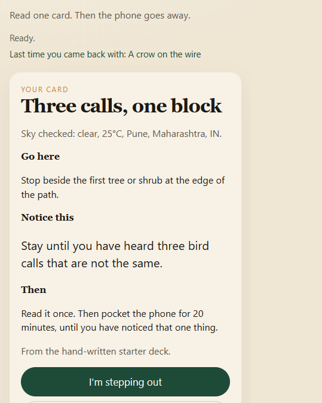
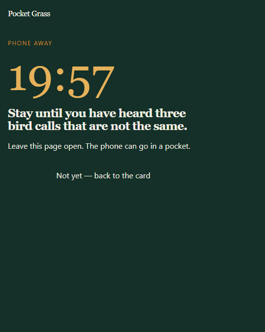
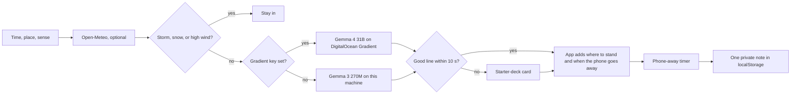

<div align="center">

# Pocket Grass

**An open model writes one outdoor card. Then the phone goes away.**

[](LICENSE)
[](https://nodejs.org/)
[](https://ai.google.dev/gemma)
[](https://www.digitalocean.com/)
[](https://dev.to/challenges/hacktoberfest-week1-2026-10-05)

**[Try it live → pocket-grass-ct89s.ondigitalocean.app](https://pocket-grass-ct89s.ondigitalocean.app/)**

</div>

---

## Overview

Pocket Grass is a small web app for people who keep meaning to go outside and don't.

You choose how long you have, where you are standing, and what you want to notice first. A Gemma model finishes **one sentence** about what to notice. The app adds where to stand and when the phone goes away. You tap **I'm stepping out**, the screen turns into a countdown, and when it ends you can keep one sentence about the walk on your own device.

<p align="center">
  
  
  
</p>

It is built for the [Hacktoberfest Open-Source AI Challenge, Week 1: Touch Grass](https://dev.to/challenges/hacktoberfest-week1-2026-10-05).

## Features

- **Three outing lengths**: 10, 20, or 40 minutes.
- **One-sentence prompt from Gemma**: the model finishes a sentence that code has already started, so a small model stays on task.
- **Weather-aware**: type a city and [Open-Meteo](https://open-meteo.com/) supplies the sky. No API key and no account.
- **Safety first**: thunder, snow, or very high wind never reaches the model. The app tells you to stay in.
- **Phone-away timer**: a plain countdown, then an optional one-line note.
- **Private by default**: notes are stored in `localStorage` on your device. There is no database and no sign-in.
- **Runs two ways**: Gemma 3 270M on your own machine, or Gemma 4 31B on DigitalOcean Gradient when a key is set.
- **Never stuck**: if the model is warming up, busy, slow, or returns a bad line, you get a card from a hand-written starter deck matched to your place, sense, and sky. Each card says where it came from.

## How it works



### Why the model only writes one sentence

A 270M-parameter model will copy a long template. It will, however, finish a sentence that has already started. So the sentence stem is written in code, the model completes it, and a parser checks the result. If the output is empty, a copy of an example, or malformed, the app tries again, and after that it falls back to the starter deck instead of showing an error.

Everything that must be correct stays in tested code, not in the model: the weather rules, the stay-in decision, the place line, and the timer.

## Tech stack

| Layer | Choice |
| --- | --- |
| Runtime | Node.js 20+, no web framework |
| Local model | [`onnx-community/gemma-3-270m-it-ONNX`](https://huggingface.co/onnx-community/gemma-3-270m-it-ONNX), q8, via [Transformers.js](https://huggingface.co/docs/transformers.js) |
| Hosted model | `gemma-4-31B-it` on [DigitalOcean Gradient serverless inference](https://docs.digitalocean.com/products/gradient-ai-platform/) |
| Weather | [Open-Meteo](https://open-meteo.com/) forecast and geocoding APIs |
| Front end | Plain HTML, CSS, and JavaScript |
| Hosting | [DigitalOcean App Platform](https://www.digitalocean.com/products/app-platform) from the `Dockerfile` |
| Tests | Node's built-in test runner |

## Getting started

### Requirements

- Node.js 20 or newer
- A few hundred MB of free disk space for the local model (downloaded on first run)

### Run locally

```bash
git clone https://github.com/surajns0033-collab/pocket-grass.git
cd pocket-grass
npm install
npm start
```

Open <http://localhost:4173>. The first start downloads the Gemma weights, and the page shows progress. After that, writing a card needs no network. Only the optional city lookup does.

The server also prints a LAN address so you can open the app on your phone.

### Run the tests

```bash
npm test
```

## Configuration

Copy `.env.example` to `.env`, or set these variables on your host.

| Variable | Default | Purpose |
| --- | --- | --- |
| `PORT` | `4173` | HTTP port. |
| `MODEL_ID` | `onnx-community/gemma-3-270m-it-ONNX` | Local model, used when no Gradient key is set. |
| `MODEL_DTYPE` | `q8` | Quantization of the local model. |
| `LOCAL_MODEL` | _on_ | Set to `off` to skip the local model (the Docker image does this). Cards then come from Gradient or the starter deck. |
| `CARD_DEADLINE_MS` | `10000` | How long to wait for the model before using the starter deck. |
| `DIGITALOCEAN_INFERENCE_KEY` | _unset_ | Gradient model access key. When set, cards are written by the hosted model. |
| `DIGITALOCEAN_INFERENCE_URL` | `https://inference.do-ai.run/v1` | Gradient inference endpoint. |
| `DIGITALOCEAN_INFERENCE_MODEL` | `gemma-4-31B-it` | Hosted model id. |

Never commit a real key. `.env` is in `.gitignore`.

## Deploy to DigitalOcean

The repository includes a `Dockerfile` and an App Platform spec at [`.do/app.yaml`](.do/app.yaml).

**From the control panel**

1. Create an app and connect this GitHub repository.
2. Keep the detected Dockerfile and the HTTP port `4173`.
3. Add `DIGITALOCEAN_INFERENCE_KEY` as an encrypted environment variable. Create the key under **Model Access Keys** in the DigitalOcean AI Platform.
4. Deploy. Pushes to `main` redeploy automatically.

**From the command line**

```bash
doctl apps create --spec .do/app.yaml
```

Then set the `DIGITALOCEAN_INFERENCE_KEY` secret on the new app.

Check the deployment at `/api/health`. It reports the active backend (`digitalocean-gradient` or `local-gemma`) and the model in use.

The live instance runs on a single $12/month App Platform container in Bangalore (BLR1). The container does not load the local model, because 1 GB of RAM is too little for it to run alongside the server.

## API

| Method | Path | Description |
| --- | --- | --- |
| `GET` | `/api/health` | Model status, backend, and any load error. |
| `POST` | `/api/card` | Writes a card. Body: `{ "minutes": 10 \| 20 \| 40, "place": string, "sense": string, "city"?: string, "take"?: number }`. |

If the weather says to stay in, `/api/card` returns `{ "stayIn": true, "reason": "..." }` and the model is not called. Every other card includes `source` (`gemma` or `starter`) so the page can say who wrote it.

## Project structure

```text
.
├── server.js              HTTP server, model loading, card generation
├── lib/
│   ├── catalog.js         Times, places, senses, and example cards
│   ├── prompt.js          Gemma chat template and prompt builder
│   ├── assemble.js        Sentence stem and final card assembly
│   ├── parse.js           Cleans model output and rejects near-copies
│   ├── weather.js         Open-Meteo lookup and stay-in rules
│   └── gradient.js        DigitalOcean Gradient client
├── public/                Front end (HTML, CSS, JS)
├── test/                  Unit tests
├── .do/app.yaml           App Platform spec
├── Dockerfile
└── .env.example
```

## Hacktoberfest 2026

| | |
| --- | --- |
| Challenge | [Week 1: Touch Grass](https://dev.to/challenges/hacktoberfest-week1-2026-10-05) |
| Window | Closes October 11, 2026, 11:59 PM PDT (October 12, 2026, 06:59 UTC) |
| Partner technologies | Gemma, DigitalOcean (App Platform and Gradient), GitHub |

The project was started inside the challenge window. Commits made after the deadline are listed in the git history.

## Credits

- **Gemma** by Google. Local build: [`onnx-community/gemma-3-270m-it-ONNX`](https://huggingface.co/onnx-community/gemma-3-270m-it-ONNX), run with [Transformers.js](https://huggingface.co/docs/transformers.js).
- **Gemma 4 31B Instruct** on [DigitalOcean Gradient](https://docs.digitalocean.com/products/gradient-ai-platform/details/models/).
- **Weather data** by [Open-Meteo](https://open-meteo.com/), licensed [CC BY 4.0](https://creativecommons.org/licenses/by/4.0/).

## License

The code in this repository is released under the [MIT License](LICENSE). Model weights and the Open-Meteo data keep their own licenses.
