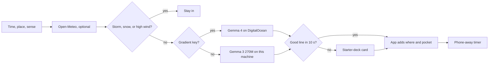

*This is a submission for the [Hacktoberfest Open-Source AI Challenge Week 1: Touch Grass](https://dev.to/challenges/hacktoberfest-week1-2026-10-05)*

The card is supposed to be the short part. I kept asking a small open model to write the whole outing, and it kept handing me more screen.

## What I built

Pocket Grass is a page for the minute before you go outside.

You choose 10, 20, or 40 minutes, a place to start (sidewalk, park, balcony, garden, or trail), and what you notice first. A city is optional. If you type one, [Open-Meteo](https://open-meteo.com/) reports the sky. There is no weather API key.

Then **Gemma** finishes one sentence: the thing you are going out to notice.

- On a laptop: [Gemma 3 270M Instruct](https://huggingface.co/onnx-community/gemma-3-270m-it-ONNX), q8 ONNX, through [Transformers.js](https://huggingface.co/docs/transformers.js). After that download, the card does not need the network.
- On DigitalOcean: the same app calls [Gradient serverless inference](https://docs.digitalocean.com/products/gradient-ai-platform/details/models/) with model id `gemma-4-31B-it`. The app runs on App Platform: **[pocket-grass-ct89s.ondigitalocean.app](https://pocket-grass-ct89s.ondigitalocean.app/)**.

The app, not the model, writes the other two lines. Where to stand. When the phone goes away. Thunder, snow, or a high wind never gets to the model. The page tells you to stay in. Those checks are unit-tested.

You tap **I'm stepping out.** The page turns into a timer. The phone can go in a pocket. When it ends, you can keep one sentence on that device. It is not uploaded.

## A real card

The first working card, tonight in Pune: clear, 24°C, after dark. Four seconds.

**The crunch of leaves**

- **Go here:** Stop beside the first tree or shrub at the edge of the path. It is dark, so stay close.
- **Notice this:** Listen until you hear the crunch of leaves on the ground.
- **Then:** Read it once. Then pocket the phone for 20 minutes, until you have noticed that one thing.

The model wrote "the crunch of leaves on the ground." The rest is the app, including the lead-in "Listen until you hear", because it is night and looking at a leaf edge would be a bad assignment.

I have not walked this one yet. The practice timer (15 seconds) runs on the same page so you can see the ending without pretending you went outside.

## Why the model only finishes a sentence

The first prompts asked for four labeled lines. The small model copied them. It copied the angle brackets. One generation told me to sweep steps in Pune with a broom.

A small open model will echo a template. It will finish a sentence that has already started. So the sentence starts in code. At night, or in the rain, or when you asked for birds or quiet, the start is about sound. If the ending repeats the prompt or sprouts a number, it is thrown out and tried again.

My first version showed an error when that kept failing. Then I watched it happen on the hosted copy: a spinner, a wait, then an apology. That is exactly the screen time the app is supposed to cut. Now, if Gemma is warming up, busy, slower than ten seconds, or still wrong, the card comes from a small hand-written starter deck matched to your place, your sense, and the sky. The card says which one wrote it, so you always know.

That is why Gemma belongs here. I could read the bad text on this machine and change the job until it fit. The same Gemma family then runs larger, as Gemma 4, on DigitalOcean Gradient when a key is present. A closed API would have written a smoother paragraph, and the plan would have left the house to do it.

People already running Transformers.js on their own machines describe the same trade: ONNX, no key, and a small model. [Run Models in the Browser With Transformers.js](https://dev.to/kenzic/run-models-in-the-browser-with-transformersjs-7g8) is the Node path. [Run Your Offline AI Chat](https://dev.to/dchif/run-your-offline-ai-chat-assistant-pure-browser-zero-backend-1e48) ships a tiny Gemma-class model for the same reason, size.

## Try it

Live: [pocket-grass-ct89s.ondigitalocean.app](https://pocket-grass-ct89s.ondigitalocean.app/) (no sign-in)

Repo: [github.com/surajns0033-collab/pocket-grass](https://github.com/surajns0033-collab/pocket-grass)

To run it on your own machine, with Gemma 3 270M and no network after the first download:

```bash
npm install
npm start
```

Open http://localhost:4173. The first local start downloads Gemma 3 270M into `.cache/`.



## Prize categories

- **Best Use of Gemma** — Gemma 3 270M locally (ONNX, Transformers.js). Gemma 4 31B Instruct on DigitalOcean Gradient (`gemma-4-31B-it`) when a model access key is set.
- **Best Use of DigitalOcean** — the app is live on App Platform (one container in Bangalore, built from the `Dockerfile`, redeployed on every push to `main`). Card writing on the hosted path goes through Gradient's OpenAI-compatible endpoint at `https://inference.do-ai.run/v1`. The container does not load the local model: on 1 GB of RAM it crashed the server, which is why the starter deck exists.
- **Best Use of GitHub Copilot** — the repo carries Copilot project instructions in `.github/copilot-instructions.md`, so a Copilot agent working on it knows the rules: the model only finishes one sentence, and safety stays in code.
